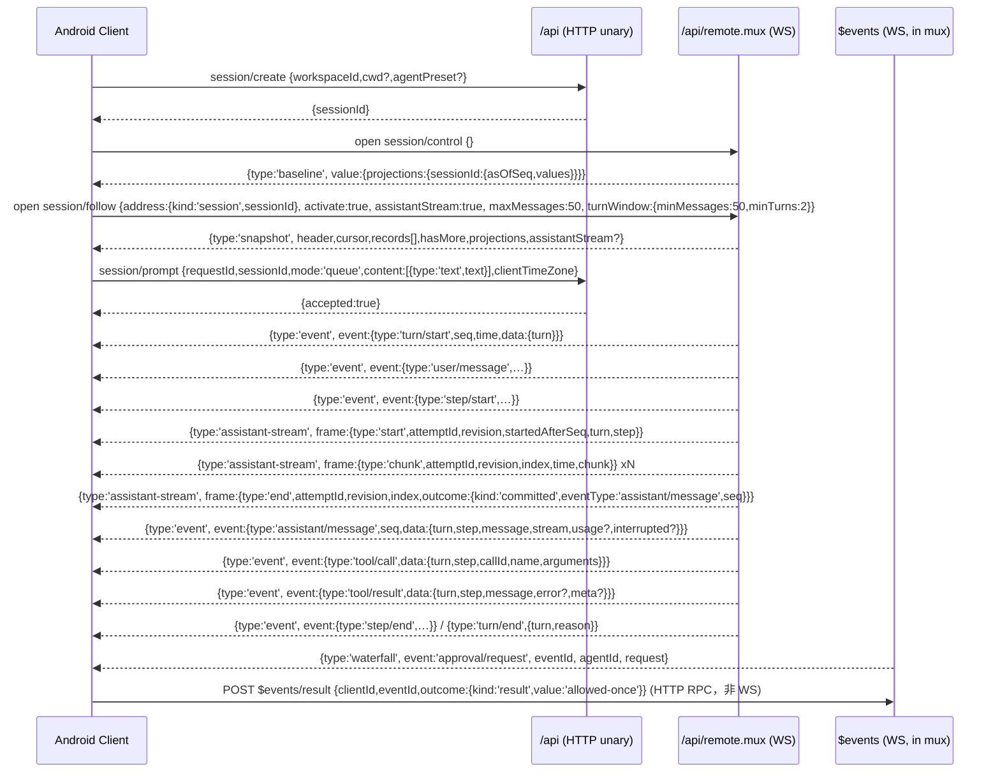

# DSH Remote API 面（安卓原生聊天客户端用）

> 依据：发行包 `@deepseek-ai/dsh@0.2.2-alpha.2`（只读）。下文所有路径均相对于
> `PKG = /usr/lib/node_modules/@deepseek-ai/dsh/node_modules/@deepseek-ai`，写作 `PKG/pkg/file:line`。
> 类型声明来自各包 `lib/typert.remote-client.d.ts`（生成产物，注释原样保留）与 `lib/types/*.d.ts`。
> 本文只覆盖「Host ↔ 非浏览器客户端」的 wire 面；React 客户端内部 API（`ctx.sessions` 等）不算 Remote 面。

## 0. 传输层三件事（先记住，后面都靠它）

| 事实 | 值 | 出处 |
|---|---|---|
| RPC 通道前缀 | `/api`，一元端点 URL 即 `/api/<namespace>/<method>` | `PKG/dsh-client-connection/lib/types/api-path.d.ts:6`；端点拼接 `PKG/dsh-client-connection/lib/index.js:927`；`PKG/dsh-api-gateway/lib/client.browser.js:2077-2078`（`${namespace}/${method}`） |
| 一元请求体 | `{type:'client-request', rpcId, method, payload:{args:{...}}}`，`Content-Type: application/json`，仅 `POST` | `PKG/dsh-client-connection/lib/types/rpc.d.ts:62-67`；`PKG/dsh-api-gateway/lib/client.browser.js:1826`；`PKG/dsh-client-connection/lib/index.js:892-899` |
| 一元响应体 | `{type:'server-response', rpcId, result:{ok:true,value}|{ok:false,error:{code,message,details}}}` | `PKG/dsh-client-connection/lib/types/rpc.d.ts:69-73,13-17` |
| 含字节结果 | 同一 JSON 换成 `multipart/form-data`：`metadata` 分片 + `bytes-<n>` 分片，metadata 内 `attachments[].path` 指向值里的 `null` 占位 | `PKG/dsh-client-connection/lib/index.js:954-980`；`rpc.d.ts:26-32` |
| 流通道 | 唯一 WebSocket `/api/remote.mux`，同一连接复用所有流（按 `streamId` 多路） | `PKG/dsh-api-gateway/lib/types/stream-protocol.d.ts:4` |
| 客户端流帧 | `{type:'open',streamId,endpoint,payload}` / `{type:'item',streamId,value?}` / `{type:'end',streamId}` / `{type:'cancel',streamId}` | `stream-protocol.d.ts:126-141` |
| 服务端流帧 | `{type:'item',streamId,value?}` / `{type:'error',streamId,error}` / `{type:'end',streamId}` | `stream-protocol.d.ts:149-160` |
| 认证入口 | `GET /connect?token=<launch-token>&interactions=answer\|none` → 302 到 `./api/remote.mux` 并发 Cookie；聊天客户端必须 `interactions=answer`，否则收不到 waterfall | `PKG/dsh-client-connection/lib/types/connect-protocol.d.ts:3,5`；`PKG/dsh-api-gateway/lib/client.browser.js:1631` |

流句柄语义（客户端实现基准）：`RemoteStreamHandle<Out,In>` = 下行 `AsyncIterable<Out>` + `send(item)` / `end()` / `dispose()`；`open` 帧到达前发送的 uplink 项排队；`dispose()` 发 `cancel`。出处 `PKG/dsh-typert-protocol/lib/types/types.d.ts:143-161`。

## 1. 命名空间/方法总表（按域分表，首列含命名空间）

### 1.1 session / skills / fileReferences（`PKG/dsh-api-session-controller/lib/typert.remote-client.d.ts`）

| # | method | params | return | 类型 |
|---|---|---|---|---|
|1|`session/list`|`_request: SessionListRequest`（`{cursor?:string}`）|`SessionListValue`（`{items:SessionSummary[]}`）|unary|
|2|`session/create`|`request: SessionCreateRequest`（`{workspaceId?,cwd?,sessionId?,agentPreset?}`）|`SessionCreateValue`（`{sessionId,agentPreset?}`）|unary|
|3|`session/prompt`|`request: SessionPromptRequest`（`{requestId,sessionId,mode:'queue'\|'steer',content:PromptContentPart[],clientTimeZone?}`）|`SessionPromptValue`（`{accepted:true}`）|unary|
|4|`session/cancel`|`{sessionId}`|`{accepted:true}`|unary|
|5|`session/state`|`{sessionId}`|`SessionState`|unary|
|6|`session/observeState`|`{sessionId}`|`SessionState`|**stream**|
|7|`session/wait`|`{sessionId,timeoutMs?,afterSeq?,maxMessages?}`|`SessionWaitValue`（`{reason:'idle'\|'input-required'\|'timeout',state,output}`）|unary（默认 30s，`index.js:2200`）|
|8|`session/events`|`request: SessionPageRequest`|`SessionEventsPage`|unary|
|9|`session/page`|同 `events`|同 `events`|unary，**已弃用别名**（`types.d.ts:600-606`）|
|10|`session/follow`|`request: SessionFollowRequest`（`address,activate?,assistantStream?:true,maxMessages?,turnWindow?`）|`SessionFollowFrame`|**stream**|
|11|`session/observeEvent`|`{address: SessionAddress}`|`SessionEventFrame`|**stream**|
|12|`session/control`|无参|`SessionControlFrame`|**stream**（全局，进程级 projection 基线）|
|13|`session/projections`|`{sessionId}`|`SessionProjectionsValue`（`{kind:'sequenced',asOfSeq,values}` / `{kind:'migration-required',values}` / `null`）|unary|
|14|`session/observeProjections`|`{sessionId}`|`SessionProjectionFrame`|**stream**|
|15|`session/rename`|`{sessionId,title}`|`{title,seq}`|unary|
|16|`session/fork`|`{sessionId,atSeq?,allowMigration?}`|`{sessionId}`|unary|
|17|`session/search`|`{query}`|`{items:SessionSearchItem[],hasMore}`（上限 20 条/片段 240 code point）|unary|
|18|`session/selectModel`|`{sessionId,provider,model,reasoningEffort?}`|`{selected:ModelSelection}`|unary|
|19|`session/modelCatalog`|无参|`ModelCatalog`（`{default,routableProviders,groups,failures}`）|unary|
|20|`session/attachment`|`{sessionId,attachment:ImageAttachmentRef}`|`{attachment,data:base64}`|unary|
|21|`session/updateQueue`|`{sessionId,itemId,action:QueueAction}`（`edit'\|'remove'\|'steer'`）|`{accepted:true}`|unary|
|22|`session/canOpenWorkspacePath`|无参|`boolean`|unary|
|23|`session/openWorkspacePath`|`{path,action?:'reveal',application?}`|`{opened:true}`|unary（Host 桌面专用，安卓不可用）|
|24|`session/workspacePathApplications`|`{path}`|`SessionWorkspacePathApplication[]`|unary（桌面专用）|
|25|`session/initializeDefaultModel`|无参|`void`|unary|
|26|`skills/list`|`{sessionId}`|`{skills:SkillEntry[]}`|unary|
|27|`fileReferences/list`|`(agentId: SessionId, query: string)` 位置参数|`FileReferenceCandidate[]`（`{path,kind:'file'\|'directory'}`）|unary|

服务端错误码（客户端必须分支处理）：`session/observation-ended`、`session/wait-timeout`、`session/conflict`、`session/writer-held`、`session/agent-busy`、`session/projections-unavailable`、`session/attachment-invalid`、`session/migration-required`、`session/fork-unavailable`、`session/queue-item-not-found`、`subagent/not-found`——`PKG/dsh-api-session-controller/lib/types/types.d.ts:158-223`。网关级通用码 `gateway/*` 共 22 个，`PKG/dsh-api-gateway/lib/types/remote-error-codes.d.ts:14-36`。

### 1.2 workspace / directoryPicker / workspaceFiles

| method | params | return | 类型 | 出处 |
|---|---|---|---|---|
|`workspace/create`|`{path}`|`{workspace,created}`|unary|`PKG/dsh-api-workspace-controller/lib/typert.remote-client.d.ts:19`|
|`workspace/initializeDefault`|无参|`WorkspaceValue\|undefined`|unary|同`:22`|
|`workspace/rename`|`{workspaceId,title}`|`{workspace}`|unary|`:26`|
|`workspace/delete`|`{workspaceId}`|`{deleted:true}`|unary|`:20`|
|`workspace/insertBefore` / `insertSessionBefore`|`{workspaceId,beforeWorkspaceId?}` / `{workspaceId,sessionId,beforeSessionId?}`|`{workspaceIds}` / `{workspace}`|unary|`:23-24`|
|`workspace/archiveSession` / `unarchiveSession`|`{sessionId,stopActivity?}` / `{sessionId}`|`{archivedSessionIds}`|unary|`:18,27`|
|`workspace/pinSession` / `unpinSession`|`{sessionId}`|`{pinnedSessionIds}`|unary|`:25,28`|
|`workspace/follow`|无参|`WorkspaceFollowFrame`(`baseline`\|`replace`\|`upsert`\|`remove`\|`order`\|`archived`\|`pinned`)|**stream**|`:21`；帧定义 `PKG/dsh-api-workspace-controller/lib/types/types.d.ts:154-177`|
|`directoryPicker/list`|`(path?: string)`|`DirectoryListing`|unary|`PKG/dsh-api-workspace-controller/lib/typert.remote-client.d.ts:14`|
|`directoryPicker/pick`|无参|`string\|null`|unary（桌面原生对话框，安卓忽略）|`:15`|
|`workspaceFiles/list`|`(sessionId, path)`|`WorkspaceDirectoryListing`（`{path,entries[{name,type,size?}],truncated}`）|unary|`PKG/dsh-api-workspace-files/lib/typert.remote-client.d.ts:15`；值 `.../types/types.d.ts:83-111`|
|`workspaceFiles/read`|`(sessionId, path, range:{offset?,limit?})`|`WorkspaceFileText`（`{absolutePath,version,bytes?,offset,text,lines,eof}`）|unary|`:16`|
|`workspaceFiles/stat`|`(sessionId, path)`|`WorkspaceFileStat`|unary|`:18`|
|`workspaceFiles/readBytes`|`(sessionId, path, options:{range?,baseFile?})`|`WorkspaceFileBytes`（**字节结果**，走 multipart 附件）|unary，`TYPERT_REMOTE` 标 `'unary', never, RemoteDecoded<...>`|`:17`；`:36`|
|`workspaceFiles/changes`|`(sessionId, path)`|`WorkspaceFileWatchFrame`|**stream**|`:14`|

### 1.3 settings / credentials / account / llm / permission / agentPresets

| method | params | return | 类型 | 出处 |
|---|---|---|---|---|
|`settings/describe`|无参|`SettingsDescribeValue`|unary|`PKG/dsh-api-settings-controller/lib/typert.remote-client.d.ts:18`|
|`settings/update`|`(ns, patch, expectedRevision?)`|`SettingsNamespaceView`|unary（乐观并发）|`:22`|
|`settings/replace`|`(ns, section, expectedRevision?)`|`SettingsNamespaceView`|unary|`:21`|
|`settings/mutate`|`(ns, ops[], expectedRevision?)`|`SettingsNamespaceView`|unary|`:19`|
|`settings/openSettingsDocument`|无参|`SettingsDocumentOpenValue`|unary（桌面打开本地文件）|`:20`|
|`credentials/describe` / `set` / `unset`|`(refs[])` / `(ref,value)` / `(ref)`|`Record<string,CredentialInfo>` / `void` / `void`|unary|`:13-16`|
|`account/getState`|无参|`AccountView`|unary|`PKG/dsh-api-account-controller/lib/typert.remote-client.d.ts:21`|
|`account/startSignIn`|`(client, callbackOrigin, 'web'\|'desktop')`|`AccountView`|unary|`:26`|
|`account/cancelSignIn` / `signOut`|`(attemptId)` / `(client)`|`AccountView`|unary|`:15,24`|
|`account/getBalance` / `getProfile` / `getUnnotifiedBonuses` / `ackBonusNotified`|`(client)`…|`AccountDetails[...]\|null` / `AccountBonusBatch\|null` / `boolean`|unary|`:16,17,19,13`|
|`account/watch` / `watchExpiry`|无参|`AccountView` / `'session-expired'`|**stream** ×2|`:27,28`|
|`llm/listProviders` / `listConfigurableProviders` / `discoverModels`|无参 / 无参 / `(settingsNs, request)`|`LlmProviderInfo[]` / `LlmConfigurableProvider[]` / `LlmDiscoveredModel[]`|unary|`PKG/dsh-llm/lib/typert.remote-client.d.ts:13-15`|
|`permissionPresets/catalog`|无参|`PermissionCatalog`（`{options,defaultOptions,defaultPreset}`）|unary|`PKG/dsh-permission-presets/lib/typert.remote-client.d.ts:11`；值 `.../types/types.d.ts:22-30`|
|`agentPresets/list` / `read` / `select`|无参 / `(agentPreset)` / `(agentId, agentPreset)`|`AgentPresetRoster` / `AgentPresetDocument` / `string`|unary|`PKG/dsh-agent-preset-registry/lib/typert.remote-client.d.ts:12-14`|

### 1.4 jobs / terminal / approval-ish / userQuestions / goals / schedule / subagents

| method | params | return | 类型 | 出处 |
|---|---|---|---|---|
|`job/list`|`{sessionId}`|`JobListFrame`（`{type:'rows',jobs:JobView[]}`，整集替换）|**stream**|`PKG/dsh-api-job-controller/lib/typert.remote-client.d.ts:15`；帧 `.../types/types.d.ts:20-23`|
|`job/follow`|`{sessionId?,jobId,from?}`|`JobFollowFrame`（`opened`\|`output{chunks,next,lossy?}`\|`status`）|**stream**|`:13`；`:66-81`|
|`job/kill`|`{sessionId,jobId}`|`{outcome:'requested'\|'already-finished'}`|unary|`:14`|
|`terminal/create`|`(agentId, {shellPath?,id,cols,rows})`|`WebTerminalInfo`|unary|`PKG/dsh-api-terminal-controller/lib/typert.remote-client.d.ts:20`|
|`terminal/list`|`(sessionId)`|`WebTerminalInfo[]`|unary|`:23`|
|`terminal/attach`|`(agentId, id)`|`TerminalFrame`（`snapshot`\|`output`\|`state`\|`ack`），**带 uplink** `TerminalInput`（`write{sequence,data}`\|`resize`）|**stream + 双向**|`:18`；帧 `.../types/types.d.ts:63-96`|
|`terminal/shells` / `environment` / `close` / `rename` / `retain`|`(agentId…)`|`TerminalShell[]` / `TerminalEnvironment` / `void` / `void` / `TerminalRetentionFrame`|unary ×4 + stream ×1|`:19,21,22,24,25`|
|`userQuestions/answer`|`(agentId, callId, AskUserQuestionAnswer{answers:[{id,selected[],custom?}]})`|`boolean`|unary|`PKG/dsh-user-questions/lib/typert.remote-client.d.ts:14`|
|`userQuestions/attachWait`|`(agentId, callId)`|`{remainingMs}`|**stream**|`:15`|
|`goals/create` / `get` / `edit` / `pause` / `resume` / `complete` / `clear`|`(agentId[,ref,request])`|`{ref}` / `GoalView\|undefined` / `GoalView` / `GoalRef`|unary ×7|`PKG/dsh-goal/lib/typert.remote-client.d.ts:12-18`|
|`schedule/list`|`{sessionId}`|`ScheduleRecord[]`|unary|`PKG/dsh-schedule/lib/typert.remote-client.d.ts:19`；请求 `.../types/types.d.ts:335-338`|
|`schedule/update`|`{sessionId,id,expected:ScheduleRecord,change?,...}`|`ScheduleUpdateResult`（含 `updated:false` + `code:'schedule_not_found'\|'schedule_ended'\|'schedule_conflict'` 的非变更失败）|unary|`:21`；`:369-386`|
|`schedule/delete` / `deleteInactive` / `history` / `catalog`|…|`ScheduleDeleteResult` / `ScheduleDeleteInactiveResult` / `ScheduleDeliveryHistoryResult`（`{limit,before?}` 游标式）/ `ScheduleCatalogEntry[]`|unary ×4|`:15-18,20`|
|`subagents/prompt`|`{requestId,parentSessionId,childSessionId,mode:'continuable',delivery:'queue'\|'steer',content,clientTimeZone?}`|`{messageId}`|unary|`PKG/dsh-subagent/lib/typert.remote-client.d.ts:17`；`.../control-types.d.ts:78-99`|
|`subagents/interruptByParent`|`(childSessionId,parentSessionId,'continuable')`|`{accepted:true}`|unary|`:15`|

### 1.5 其余可挂载命名空间（P1/P2 用）

| namespace/method | params → return | 类型 | 出处 |
|---|---|---|---|
|`commands/list` / `commands/execute`|`(agentId)` → `CommandDescriptor[]`；`(agentId,line,submittedAttachments[])` → `CommandExecution\|undefined`|unary|`PKG/dsh-commands/lib/typert.remote-client.d.ts:13-14`|
|`fileUploads/upload`|`(agentId,{data:base64,name?})` → `{receiptId,file}`|unary|`PKG/dsh-client-file-upload/lib/typert.remote-client.d.ts:11`|
|`actionCards/act`|`(agentId,callId,verb,payload?)` → `ActionCardResult`|unary|`PKG/dsh-action-cards/lib/typert.remote-client.d.ts:14`|
|`toolResults/watch`|`{request}` → `SessionToolResultValue`|**stream**|`PKG/dsh-client-ui-trajectory/lib/typert.remote-client.d.ts:12`|
|`messageFeedback/list` / `put` / `delete`|`{request}` → 对应 Result|unary|`PKG/dsh-message-feedback/lib/typert.remote-client.d.ts:14-16`|
|`sessionFeedback/record`|`{request}` → `SessionFeedbackRecordResult`|unary|`PKG/dsh-command-feedback/lib/typert.remote-client.d.ts:11`|
|`sessionReferenceResolver/candidates`|`(agentId,query)` → `SessionReferenceMentionCandidate[]`|unary|`PKG/dsh-session-reference/lib/typert.remote-client.d.ts:12`|
|`remoteAccess/follow`|无参 → `RemoteAccessFrame`（`baseline{owner,grants?}`\|`upsert{grant}`\|`remove{resource}`）|**stream**|`PKG/dsh-api-remote-access/lib/typert.remote-client.d.ts:12`；帧 `.../types/types.d.ts:116-129`|

**不存在 Remote 面的域（别去找）**：`deliverables`（只在会话事件 `deliverables/presented` + HTTP 路由 `/api/present.open`、`/api/present.host`，`PKG/dsh-tool-present/lib/types/types.d.ts:10-18`、`PKG/dsh-client-ui-deliverables/lib/types/presented.d.ts:6-8`）；`agent-team`（`dsh-experimental-agent-team` 的 `lib/types/*.d.ts` 里没有 `TypertRemoteService`/`TypertRemoteNamespace` 声明，`grep` 结果为空）；审批本身也没有独立命名空间（见 §5）。

## 2. 端到端：发一条 prompt → 流式回复 → 工具调用 → 结束

### 2.1 五种帧的判别字段（逐字，客户端解析必须是 switch）

| 类型 | 判别式与字段 | 出处 |
|---|---|---|
|`SessionFollowFrame`|`{type:'snapshot', header:SessionWireHeader, cursor:number, records:SessionHistoryRecord[], hasMore:boolean, projections:SessionProjectionBaseline, assistantStream?:SessionAssistantStreamBaseline}` \| `SessionEventEntry` = `{type:'event', event:SessionWireEvent}` \| `{type:'assistant-stream', frame:SessionAssistantStreamFrame}`|`PKG/dsh-api-session-controller/lib/types/types.d.ts:525-536`|
|`SessionEventFrame`|`{type:'ready'}` \| `SessionEventEntry`|`:612-614`|
|`SessionProjectionFrame`|`{type:'ready'}` \| `{type:'projection', key, value:JsonValue, seq:number}`|`:616-622`|
|`SessionControlFrame`|`{type:'baseline', value:{projections:Record<SessionId,SessionProjectionBaseline>}}` \| `{type:'projection', sessionId, key, value, seq}`|`:549-554`|
|`SessionState`（非帧，observeState 的产出）|`{cursor:number, active:boolean, running:boolean, queue:SessionQueuedItem[]\|null, pendingInput:('approval'\|'question'\|'other')[]}`|`:565-575`|
|`SessionWireEvent`（所有持久事件的信封）|`{type:string, seq:number, time:number, data:JsonValue, ignorable?:true, sourceEventSeqs?:JsonValue, surfaceOp?:JsonValue}`|`:436-446`|
|`SessionWireHeader`|`{version:number, id, createdAt, cwd?, parentSession?, isSeeded, origin?:'subagent', delegationDepth?, agentPreset?}`|`:411-422`|
|`SessionAssistantStreamFrame`|`start{attemptId,revision,startedAfterSeq,turn,step}` / `chunk{index,time,chunk}` / `end{index,outcome:{kind:'committed',eventType,seq}\|{kind:'abandoned'}}`|`:491-518`|

持久事件 `type` 取值（`PKG/dsh-session/lib/types/types.d.ts:266-401`）：`turn/start`、`turn/end`、`step/start`、`step/end`、`user/message`、`developer/message`、`system/message`、`assistant/message`、`assistant/attempt`、`tool/call`、`tool/result`、`request/header`、`request/context`、`session/end-seed`；插件再合并 `plan/mode`（`PKG/dsh-plan-mode/lib/types/index.d.ts:44-46`）、`deliverables/presented`（`PKG/dsh-tool-present/lib/types/types.d.ts:13`）、`approval/asked`/`approval/decided`（log-only，`PKG/dsh-user-approval/lib/types/types.d.ts:37-51`）。**未知 type 必须按 `ignorable` 标记容忍**（`:441`；语义见 `PKG/dsh-session/lib/types/types.d.ts:41-56`）。

### 2.2 顺序要点（踩坑清单）
1. `follow` 必须先于 `prompt` 打开：`snapshot.cursor` 是断线重连的对齐点，否则会丢 `assistant-stream` baseline（`types.d.ts:473-489`）。
2. `prompt` 的 `requestId` 是客户端自铸的 `SessionRequestId`，Host 把它回显为 `user/message.source.rpcId`，用于乐观消息去重；重试同一 `requestId` 不会重复插消息（`types.d.ts:310-323,367-382`；README 明示幂等）。
3. `mode:'queue'` 追加新一轮，`'steer'` 打断当前轮；`content` 必须至少一个非空文本或附件，否则 `gateway/bad-request`。
4. 中断用 `session/cancel`；排队项不会随之清空，Host 到达静止后按 FIFO 恢复（`types.d.ts:346-353`）。
5. 轮询替代方案：`session/wait` 阻塞至 `idle|input-required|timeout`，超时默认 30s（`index.js:2200`）；`observeState` 在 wait 内 1000ms 强制刷新一次（`index.js:2266`）。
6. `session/control` 每代只发一次 `baseline`，之后只发按 key 的 `projection`；重连要整表替换，别把帧当增量 merge（`types.d.ts:537-554`）。

## 3. 会话列表与历史分页

| 项 | 字段 | 出处 |
|---|---|---|
|`SessionListValue`|`{items: SessionSummary[]}`，**无 hasMore**；分页靠请求侧 `cursor?`|`PKG/dsh-api-session-controller/lib/types/types.d.ts:245-252`|
|`SessionSummary`|`{agentAvailable,formatStatus?:'current'\|'migration-required',sessionId,updatedAt,running,blank,parentSessionId?,origin?:'subagent',cwd?,projections?:SessionProjectionHints}`|`:134-148`|
|`SessionProjectionHints`|`{kind:'cached'\|'sequenced', asOfSeq:number, values:Partial<SessionProjectionSummaryValues>}`——`cached` 的 `asOfSeq` **不可**与连接态比较|`:38-51`|
|`SessionPageRequest`|`{address:SessionAddress, throughSeq?, beforeSeq?, maxMessages?, turnWindow?:{minMessages,minTurns}}`|`:447-464`|
|`SessionAddress`|`{kind:'session',sessionId}` \| `{kind:'subagent',parentSessionId,childSessionId,mode:'one-shot'\|'continuable'\|'unknown'}`|`:384-393`|
|`SessionEventsPage`（=`SessionPage`+cursor）|`{records:SessionHistoryRecord[], hasMore:boolean, cursor:number}`；`cursor` 是含末项（含 `throughSeq`）的持久切点|`:519-523,600-606`|
|分页默认/上限|`DEFAULT_MAX_MESSAGES = 50`；客户端 `loadOlder()` 至少 50 条消息 + 跨 2 个 turn，单页封顶 500；`loadThrough()` 每页下限 200|`PKG/dsh-api-session-controller/lib/types/history.d.ts:6`；`types.d.ts:596-599`；README「Client 引用」|
|搜索|`SESSION_SEARCH_RESULT_LIMIT=20`、`SESSION_SEARCH_SNIPPET_MAX_CODE_POINTS=240`|`types.d.ts:154-157`|

安卓侧建议：`LoadState = { throughSeq, beforeSeq }` 双游标；首次 `follow` 用 `maxMessages:50` + `turnWindow{minMessages:50,minTurns:2}`，向上翻页只递 `beforeSeq`，跳转用 `loadThrough` 语义（循环直到 `beforeSeq<=targetSeq`）。

## 4. 人在环路（HITL）：审批、提问、Plan

三者共用一条 **forwarded Remote Event** 通道，不是普通 RPC：`$events` 流（`PKG/dsh-api-gateway/lib/types/stream-protocol.d.ts:6`），服务端下行帧 `ready`/`emit`/`waterfall`/`cancel`（`:27-53`），客户端回执走 **HTTP** `POST /api/$events/result`（`:8`；`PKG/dsh-api-gateway/lib/client.browser.js:898`），body `{clientId,eventId,outcome:{kind:'next'|'result',value?}|{kind:'rejected',error}}`（`:69-81`）。

| 环节 | 通道 | 载荷 | 客户端动作 | 出处 |
|---|---|---|---|---|
|审批请求|forwarded **waterfall** `approval/request`|`{agent, toolName, callId?, reason?, displayReason?}` → 期望 `'allowed-once'\|'rejected'\|'cancelled'\|'unavailable'`|回 `$events/result` 带 value|`PKG/dsh-api-remotes/lib/types/remote-events.d.ts:21-22`；`PKG/dsh-user-approval/lib/types/types.d.ts:26,55-71,81`|
|提问请求|forwarded **waterfall** `user-questions/request`|`{questions:AskUserQuestionItem[],wait?:{callId,timed?}}` → `AskUserQuestionAnswer`|两种回法：①waterfall 直接返回 `{answers:[…]}`；②落库式 `userQuestions/answer(agentId,callId,answer)`|`remote-events.d.ts:120-121`；`types.d.ts:61-90,147-164`；`PKG/dsh-user-questions/lib/typert.remote-client.d.ts:14`|
|提问倒计时|`userQuestions/attachWait` stream|`{remainingMs}`；关闭流即释放 claim|仅计时 UI 用|`PKG/dsh-user-questions/lib/types/index.d.ts:59-67`|
|Plan 审批|复用 `ask_user_question`，`intent:{kind:'plan-review',approve:<label>,callId?}`|option 列表 + `detail`=plan markdown|按 label 回答案，**不要按顺序**推断|`PKG/dsh-user-questions/lib/types/types.d.ts:19-29`|
|是否有待办输入|`session/state.pendingInput` ∈ `'approval'\|'question'\|'other'`|——|`session/wait` 返回 `reason:'input-required'` 即应弹 UI|`types.d.ts:563,574,596`|
|审批策略（自动放行档位）|`session` projection `permissions`（`{currentValue}`）+ `permissionPresets/catalog`|会话折叠自 `permission/preset`、`sandbox/mode`、`approval/policy` 三个整值事件|投影 key 缺席 = 无权限服务，隐藏控件|`PKG/dsh-permission-presets/lib/types/types.d.ts:31-56`|
|Plan 状态|`session` projection `plan`（`PlanProjection`）+ 事件 `plan/mode {active}`|——|只读展示，切换走 `/plan` 命令|`PKG/dsh-plan-mode/lib/types/index.d.ts:38-46`；`:40-43`|

**关键约束**：审批/提问的 waterfall 只有 `interactions=answer` 的 Peer 才能接（`PKG/dsh-api-gateway/lib/client.browser.js:1631`；`connect-protocol.d.ts:3`）。安卓必须在 `/connect` 时带 `interactions=answer`，否则 Host 走别的 answerer 或阻塞。未接的请求可由 `getPendingRemoteEvents()` 侧观测（Host 侧，`PKG/dsh-api-gateway/lib/types/types.d.ts:110-124`）。

## 5. 附件/图片上传、文件引用、工作区文件浏览

| 需求 | 走法 | 出处 |
|---|---|---|
|小文件 base64 上传|`fileUploads/upload(agentId,{data,name?})` → `{receiptId,file:{attachmentId,name,bytes}}`|`PKG/dsh-client-file-upload/lib/typert.remote-client.d.ts:11`；`.../types/types.d.ts:5-16`|
|大文件流式上传（推荐）|`POST /api/session/uploadFileBinary?sessionId=&name=&mediaType=`，`Content-Type: application/octet-stream`，body=裸字节；带 `mediaType` 走图片入档，否则普通文件|`PKG/dsh-client-file-upload/lib/types/protocol.d.ts:2`；`PKG/dsh-client-file-upload/lib/index.js:13-53,179-183`|
|prompt 引用上传结果|`content:[{type:'file', receiptId}]` 或 `{type:'image',mediaType,data,name?}`（内联 base64）|`PKG/dsh-api-session-controller/lib/types/types.d.ts:66-77`|
|读回历史图片|`session/attachment({sessionId, attachment:ImageAttachmentRef})` → `{attachment,data}`；只校验 ID/格式/字节数/尺寸|`:325-335`|
|`ImageAttachmentRef`|`{attachmentId,mediaType:'image/png'\|'jpeg'\|'webp'\|'gif',bytes,width,height,name?,originalDimensions?}`；`FileAttachmentRef`=`{attachmentId,name,bytes}`（content-addressed sha256）|`PKG/dsh-attachment/lib/types/types.d.ts:7-41`|
|图片限额|`session` projection `imageLimits`（`maxImageBytes,maxImagesPerMessage,maxMessageImageBytes,maxImagePixels,maxImageDimension,mediaTypes`），summary 排除项|`types.d.ts:16-22`；`PKG/dsh-attachment/lib/types/types.d.ts:65-73`|
|`@` 文件引用补全|`fileReferences/list(agentId, query)` → `[{path,kind}]`；目录继续展开，文件收尾|`PKG/dsh-file-reference/lib/types/types.d.ts:7-12`|
|`#` 会话引用补全|`sessionReferenceResolver/candidates(agentId, query)`|`PKG/dsh-session-reference/lib/typert.remote-client.d.ts:12`|
|只读文件预览|`workspaceFiles/read`（文本分页）/ `stat` / `list`；`readBytes` 走字节附件，但整文件受 `maxFileBytes` 硬上限且超限**直接拒绝不截断**|`PKG/dsh-api-workspace-files/lib/types/types.d.ts:46-62,97-111`|
|产出文件原生打开|HTTP `GET /api/present.host`（能力元数据）、`POST /api/present.open`（桌面打开）——手机端只能拿到下载/预览链接|`PKG/dsh-client-ui-deliverables/lib/types/presented.d.ts:6-8`|
|媒体 GET|`/api/file`（带版本重定向，可长期缓存）|`PKG/dsh-api-session-controller/lib/types/media-references.d.ts:1-7`|

上传体量上限：HTTP 载体单请求默认 300 MiB 缓冲（`PKG/dsh-client-connection/lib/types/http-bridge.d.ts:12`；`PKG/dsh-client-connection/lib/index.js:30` 处 `300*1024*1024`）。

## 6. MVP 分层（按安卓界面倒推）

| 层 | 方法 | 服务的安卓界面 |
|---|---|---|
|**P0**|`session/list`、`workspace/follow`、`session/control`|会话侧栏 + 首页列表（标题/运行态/归档/置顶）|
|**P0**|`session/create`、`session/prompt`、`session/cancel`|新会话 + 输入框 + 停止按钮|
|**P0**|`session/follow`、`session/events`、`session/state`、`session/observeState`|聊天页流式气泡、工具卡片、队列 dock、重连补洞|
|**P0**|`session/rename`、`session/selectModel`、`session/modelCatalog`|会话标题、模型选择器|
|**P0**|`skills/list`、`commands/list`|输入框 `/` 与 `@` 面板|
|**P0**|`fileReferences/list`、`fileUploads/upload` 或 `/api/session/uploadFileBinary`|输入框附件/引用|
|**P0**|forwarded `approval/request` + `$events/result`|审批 BottomSheet（允许一次/拒绝）|
|**P0**|forwarded `user-questions/request` + `userQuestions/answer`/`attachWait`|提问卡片（含 Plan 审批）|
|**P1**|`job/list`、`job/follow`、`job/kill`|任务/后台作业面板|
|**P1**|`workspaceFiles/list`、`read`、`stat`、`session/attachment`|文件抽屉、图片查看器|
|**P1**|`session/search`、`session/fork`、`goals/get`|搜索页、分叉、Goal 卡片|
|**P1**|`settings/describe`、`permissionPresets/catalog`、`account/getState`、`llm/listProviders`|设置页（只读为主）|
|**P1**|`remoteAccess/follow`、`toolResults/watch`|多设备/权限状态条、工具结果下钻|
|**P2**|`terminal/*`、`workspaceFiles/changes`、`workspaceFiles/readBytes`|终端页、实时文件变更、二进制预览|
|**P2**|`directoryPicker/*`、`workspace/create|rename|delete`|工作区管理（桌面语义，手机弱化）|
|**P2**|`subagents/prompt`、`subagents/interruptByParent`、`actionCards/act`、`schedule/*`、`messageFeedback/*`、`sessionFeedback/record`|子代理续聊、定时提醒、消息反馈|
|**P2（不做）**|`pluginManager/*`、`pluginMarket/*`、`cordis/*`、`cuaAccess/*`、`speech/*`、`liveshareShares/*`、`forgePanel/*`、`officeToPdf/*`、`cotTranslation/*`、`productAnalytics/*`|——|

## 7. 版本脆弱性：怎么发现 Host 破约

| 结论 | 证据 |
|---|---|
|**协议没有版本号**。全树 `grep 'protocolVersion\|PROTOCOL_VERSION\|wireVersion\|apiVersion'` 在 `*/lib/*.js` 零命中；`TypertRemoteMethod` 只有 5 个类型参数 `<Input,Output,Mode,Uplink,DecodedOutput>`|`PKG/dsh-typert-protocol/lib/types/types.d.ts:455`（`TypertRemoteMethod<Input,Output,Mode,Uplink,DecodedOutput>`）|
|唯一的 `version` 是**持久化格式版本**，不是 API 版本：`SESSION_FORMAT_VERSION = 4`，随 `SessionWireHeader.version` 下发；`formatStatus:'migration-required'` 才是需要迁移的信号|`PKG/dsh-session/lib/types/types.d.ts:39-64`；`PKG/dsh-api-session-controller/lib/types/types.d.ts:139,412`|
|打包版本号只出现在 **Web 引导图**（`WebBootRelease.version`），走 index 注入的 `window.__DSH_BOOT__`，非 `/api` 面|`PKG/dsh-client-modules/lib/types/index.d.ts:80-81`|
|可用的运行时探针：端点存在性。`gateway/method-unavailable`、`gateway/lookup-not-found`、`gateway/definition-unavailable` 等 22 个稳定码即为「方法没了/参数不匹配」的信号|`PKG/dsh-api-gateway/lib/types/remote-error-codes.d.ts:14-36`|
|可用的结构探针：每个生成产物自带 Zod + `jsonSchema` 投影（`typert.remote-client.js` 内 `jsonSchema:{...}`），客户端可缓存首启快照做 diff|`PKG/dsh-api-session-controller/lib/typert.remote-client.js:2285`|
|前向兼容抓手：`SessionWireEvent.ignorable?:true` 允许丢弃未知事件类型；`SessionFollowFrame` 的 `type` 判别式外一切字段都应容忍新增|`PKG/dsh-api-session-controller/lib/types/types.d.ts:441`；契约注释 `PKG/dsh-session/lib/types/types.d.ts:41-56`|

**建议的客户端加固（针对 0.2.2-alpha.2 起步）**：①首启拉一次 `session/modelCatalog` + `session/list` + `permissionPresets/catalog`，把每个命名空间的「方法集合 + 错误码集合」写进本地契约快照；②所有 unary 调用统一走 `RemoteResult` 分支，遇 `gateway/method-unavailable` 降级而不是崩溃；③所有流解析用「判别式 switch + default 丢弃并上报」，绝不抛；④`snapshot.cursor`/`control baseline` 视作不透明整数，不参与计算；⑤把 `session/page` 当弃用别名，只用 `session/events`；⑥`projections.kind==='cached'` 的 `asOfSeq` 永不与 `sequenced` 混用比较。

## 8. 未解问题（交给后续研究）
- `$events` waterfall 的 `agentId` 是不透明 `RemoteEventAgentId`（`stream-protocol.d.ts:34`），与 `SessionId` 是否恒等未在类型层断言；审批/提问解析 Session 需实测。
- `terminal/attach` 的 uplink 窗口 `RemoteUplinkWindow`（`PKG/dsh-api-terminal-controller/lib/types/types.d.ts:83`）字段未在本文展开，P2 再看。
- `session/wait` 的 `output.records` 是「newest first」且 `assistant` 限定（`types.d.ts:588-593`），与 `events` 的 time-ascending 相反，客户端须分开缓存。
